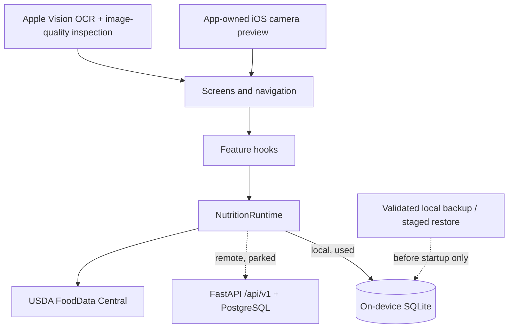

# Architecture overview

The app runs entirely on the iPhone. `NutritionRuntime` is the boundary between the UI and data:
at startup it selects one application-data authority, which is on-device SQLite (`local`). The
parked FastAPI/PostgreSQL backend can still be selected as `remote` but isn't used; see the
[backend overview](../backend/README.md). The rules behind these boundaries are in
[design decisions](decisions.md).

## System boundaries



Exactly one authority is active in a running app; local and remote are never mixed, synchronized or
used as fallbacks for each other. Local backup/restore isn't a second authority: it's a maintenance
step that can replace the local database before the runtime opens.

## Mobile layers

The normal mobile dependency direction is:

```text
screen and navigation
    -> feature hook or local use-case model
        -> NutritionRuntime interface
            -> selected local SQLite adapter
            OR selected remote API adapter -> shared API transport
```

| Layer | Responsibility | Typical location |
| --- | --- | --- |
| Navigation and screens | User flow, shared fixed route headers, draft-exit protection, accessibility, loading/error/success presentation | `src/app`, `src/features/*/screens`, `src/shared/navigation`, `src/shared/components` |
| Hooks | Authority-scoped queries, mutations, and cache invalidation | `src/features/*/hooks` |
| Feature utilities | Form state, display policy, validation, History projection, error mapping | `src/features/*/utils`, `src/features/history`, `validation`, `confirmation` |
| Runtime boundary | One composed local or remote application-data authority | `src/runtime` |
| Feature/runtime boundary | Authority-neutral request/response contracts consumed through `NutritionRuntime` | `src/features/*/api`, `src/runtime/NutritionRuntime.ts` |
| Shared nutrition reference/model | Canonical nutrient presentation, qualified units, DRI data/parity helpers | `src/shared/nutrition` |
| Shared remote transport | Base URL, headers, authentication, bounded error handling for remote mode only | `src/shared/api/client.ts` |
| Local storage | SQLite schema/migrations plus explicit local backup/restore maintenance | `src/storage/sqlite`, `src/storage/backup` |
| Native camera boundary | Back-camera lens selection used by guided nutrition capture | `src/native/camera`, `src/features/ocr/components/NutritionCameraCapture.tsx` |
| Native OCR boundary | Typed wrapper over Swift recognition and best-effort image-quality inspection | `src/native/ocr`, `modules/nutrition-ocr` |

TanStack Query owns authority-scoped in-process application-state caching. Authority changes retire
the old Query client and recovery bootstrap before the new runtime becomes usable. Zod validates
important runtime boundaries, particularly OCR and Food source contracts. React Hook Form and
feature-specific models own draft input. Each selected runtime remains the sole authority for
persisted nutrition totals.

The local restore gate is intentionally earlier than ordinary feature/runtime access. A pending
restore is validated and activated before the local application database is opened; only after that
bootstrap completes does the selected `NutritionRuntime` become usable. This is a bounded
maintenance exception, not permission for feature screens to bypass runtime authority.

## Data model

The durable model mixes mutable definitions with immutable historical facts:

- Foods, serving/reference measurements, and authored Recipes are mutable definitions.
- Recipe publication revisions are immutable snapshots.
- Daily Log nutrient snapshots are historical facts.
- Daily Log Complete assertions are explicit positive owner/date state alongside those facts; absence is not inferred `Incomplete` state.
- OCR confirmation traces are append-only creation provenance.
- Target profile/manual override/tracking-preference state is mutable configuration and never
  rewrites historical nutrition.
- Create-idempotency rows bind retry identifiers to exact payloads and response snapshots.

The [feature guides](../features/foods-and-nutrition.md) explain these in user terms.

### Complete and bounded History

Complete persistence is keyed by owner and authoritative Daily Log calendar date. It is created only
by an explicit user assertion on a non-empty date; migration, Log presence, nutrient values, older
transfer formats, and unconfirmed dates never infer it. Nutrition-changing Log mutations clear
Complete for the affected date or dates inside the same authoritative transaction. Metadata-only or
exact snapshot-preserving edits may preserve it, and later source Food/Recipe edits do not rewrite
historical snapshots or their Complete state.

History remains a read operation inside the Daily Logs capability. Local SQLite or remote
FastAPI/PostgreSQL—whichever authority was selected at bootstrap—returns one bounded inclusive
range of immutable daily evidence, Complete metadata, and earliest-log bounds. The evidence contract
accepts at most 30 calendar dates and preserves gaps, explicit zero, estimated contribution,
numeric-plus-unknown contribution, and unknown-only unavailability. Product presentation uses 7-
and 30-day ranges ending yesterday.

Authority-specific code retrieves equivalent daily evidence;
`apps/mobile/src/features/history/historyProjection.ts` is the shared projection authority for
Complete-day/Logged-day averages,
nutrient-specific usable-day counts, exact-decimal division, chart gaps, and grouped rows. Current
Targets remain a separate presentation lens. History adds no fallback, synchronization, dual read,
mixed-authority result, historical target stream, or separate persistent cache authority.

### Local SQLite

`apps/mobile/src/storage/sqlite/schema.ts` defines the fresh local semantic schema. It is
intentionally **not** a replay of PostgreSQL Alembic history. The baseline uses explicit
schema-version migration bookkeeping, exact canonical text encodings for decimal/domain values,
foreign-key enforcement, WAL mode, bounded busy handling, and local transaction/write
coordination.

Local runtime adapters under `apps/mobile/src/runtime/local` implement Calendar, nutrients, Foods,
Recipes, immutable publication, Daily Logs/snapshots, Targets, OCR, and USDA against that database.

`apps/mobile/src/storage/backup` is a separate local-maintenance boundary. It exports a coherent
validated SQLite snapshot and validates/stages a selected restore. Activation happens before
normal local-runtime open, creates a rollback snapshot of an existing database, validates the
replacement, and fails closed if safe rollback itself cannot be completed. It does not merge two
SQLite databases or synchronize with PostgreSQL.

### Write coordination

Local SQLite uses its own bounded write coordination and transactional semantics. It preserves the
same domain outcomes—atomic generations, immutable history, owner scope, replay, and rollback—
without pretending that SQLite implements PostgreSQL row locks. Cross-dimension serving-equivalence
changes are likewise applied transactionally rather than allowing a partially updated physical
measurement.

### Migrations

Schema changes are schema-version migrations under `apps/mobile/src/storage/sqlite`. Add new
migrations; never edit applied ones. The backend's Alembic streams are separate and documented in
the [backend overview](../backend/README.md#migrations).

## Mobile UX architecture

Recent UI work is intentionally centralized where behavior is cross-cutting rather than repeated
screen by screen:

- `RouteScreenHeader` and route-header actions provide fixed/sticky detail/authoring chrome with
  accessible minimum touch targets and bounded visual font growth;
- `draftGuard` and `UnsavedDraftDialog` provide semantic dirty-state exit protection for guarded
  Food, Recipe, Targets, and OCR confirmation flows;
- feature forms report dirty/busy state upward so navigation cannot race an in-flight mutation;
- shared accessibility primitives carry focus restoration, status announcement, busy/disabled
  semantics, and recovery behavior.
- Daily Log remains logging-first; Nutrition History is a secondary route under it, with four macro
  overview cards, distinct Nutrition Details/focused nutrient surfaces, and all-observation 30-day
  horizontal scrolling rather than another bottom tab.

These helpers own navigation/presentation policy. They do not become nutrition or persistence
authority.

## Tests

`apps/mobile/__tests__` (Jest) covers mobile models, authority routing, local-runtime behavior,
backup/restore policy, draft guards, route chrome and interaction flows. Native Swift tests in
`apps/mobile/modules/nutrition-ocr/ios-tests` cover Apple Vision geometry and image-quality
metrics; CI doesn't run them, so run them from Xcode after OCR changes. CI and
local commands are in the [maintenance guide](../maintenance.md#ci).
