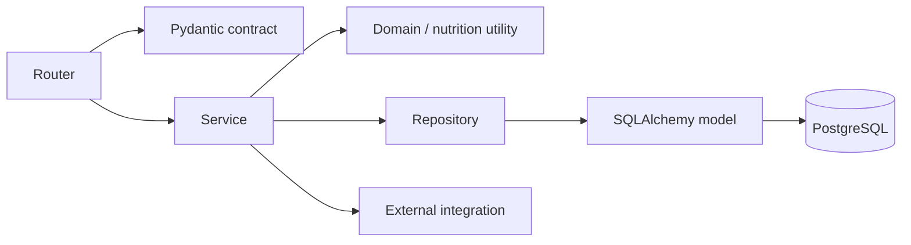

# Backend (parked)

The FastAPI/PostgreSQL backend in `apps/backend` was the app's original remote authority. The iPhone
app now runs entirely on-device (`EXPO_PUBLIC_NUTRITION_DATA_AUTHORITY=local`), so the backend is kept
only for possible future use. CI still runs its Ruff and ordinary pytest suite so it doesn't rot
(`./scripts/run-backend-baseline.sh` locally).

Nothing in this folder is needed to maintain the app. The other files here are deep-dive runbooks for
the production-hardening control plane:

- [Control plane](control-plane.md)
- [PostgreSQL runtime authority](postgresql-runtime-authority.md)
- [PostgreSQL to SQLite transfer](postgresql-to-sqlite-transfer.md)
- Runbooks: [resource membership](resource-membership.md), [immutable provenance](immutable-provenance.md),
  [target activation](target-activation.md), [recovery and cutback](recovery-and-cutback.md)

## Backend layers

### Routers

Routers translate HTTP into application calls. They resolve the authenticated user, validate
Pydantic input, choose status codes, and map known domain failures to stable API errors. Routers
should not own nutrition math, transaction choreography, or external payload mapping.

The API is versioned under `/api/v1`. Health and readiness are public; all feature routes are
authenticated.

### Services

Services own transactional use cases: create or update a Food, publish a Recipe, snapshot a Log,
confirm OCR, import USDA data, or calculate/configure target comparison. They enforce user
ownership, coordinate locks, call domain functions, maintain idempotency receipts, and commit one
coherent result.

Services are the best backend starting point for behavioral changes.

### Repositories and models

Repositories centralize persistence queries that are reused or need a clear locking/ownership
contract. SQLAlchemy models define stored relationships and database constraints. Neither layer
should decide what an HTTP error means.

Database constraints intentionally reinforce service rules: owner-scoped composite foreign keys,
one default serving, immutable revision links, source identity uniqueness, and paired revision/log
references make invalid cross-domain states difficult to persist.

### Domain, nutrition, and reference-data modules

Pure modules own decimal-safe unit conversion, serving resolution, nutrient aggregation, Recipe
projection rules, and validation. The canonical nutrient catalog under `app/catalog` owns nutrient
identity/hierarchy/default units/reference metadata. `app/targets` owns target comparison, FDA
reference projection, Mifflin–St Jeor energy estimation, and versioned DRI resolution/data. These
modules are kept independent of HTTP and normally independent of session lifecycle so they can be
tested exhaustively and mirrored by local-runtime parity logic.

Qualified micronutrient units such as `mcg RAE`, `mcg DFE`, `mg NE`, and
`mg alpha-tocopherol` are semantic units, not ordinary mass aliases. Only compatible mass units are
converted by scale; semantic units must match their canonical meaning.

### Integrations

`app/integrations/usda` is the remote FoodData Central boundary. In local mode, the local USDA
adapter talks directly to FoodData Central through the separately configured personal-credential
mechanism. Both paths map variable upstream payloads into the app's stable nutrient and serving
model; the shared backend USDA credential is never embedded in the mobile app.

## API organization

| Prefix | Capability |
| --- | --- |
| `/api/v1/health`, `/api/v1/ready` | Liveness and bounded database readiness |
| `/api/v1/nutrients` | Canonical nutrient catalog |
| `/api/v1/foods` | Saved Foods, servings/reference measurements, favorites, recents, duplication, resolution |
| `/api/v1/recipes` | Recipe authoring, calculation, publication, deletion |
| `/api/v1/logs` | Daily Log creation, editing, deletion, Complete mutation/recovery, bounded History evidence, and summaries |
| `/api/v1/usda` | USDA search, preview, and import |
| `/api/v1/ocr/nutrition-label` | Pure parsing and confirmed Food creation |
| `/api/v1/targets` | Profiles, tracking preferences, manual overrides, DRI/FDA references, effective targets, and daily comparison |

Use FastAPI's generated `/docs` for field-level request/response exploration. The guides explain
meaning and ownership rather than duplicating generated schema details.

## Remote PostgreSQL persistence

The preserved FastAPI/SQLAlchemy implementation persists the same application semantics in
PostgreSQL when `NutritionRuntime` selects `remote`. PostgreSQL-specific constraints, lock
protocols, role topology, Alembic migration history, and production-hardening machinery remain
intact and are not weakened by local mode.

Remote mutations use deterministic PostgreSQL lock protocols where Food and Recipe dependency
graphs can race. Food rows are locked in UUID order before dependent Recipe rows; authored Recipe
graph-edge changes serialize graph discovery per owner. PostgreSQL concurrency tests are the
authority for those row-lock guarantees.

## Migrations

1. **Application Alembic migrations** under `apps/backend/app/migrations` preserve the PostgreSQL
   application's migration lineage. Current head: `0033_complete_runtime_authority` (the lineage
   includes the specially authorized `0021_target_activation_execution` revision).
2. **Control Alembic migrations** under `apps/backend/app/control_migrations` change only the
   independent operations database. Current head: `ops_0011_phase5c4_recovery_audit`.

The two streams must never be pointed at each other's database. Neither is related to the mobile
app's SQLite schema migrations.

## Configuration and authentication

Backend configuration is validated at construction time:

- `development` creates/uses one deterministic development user.
- `test` provides a deterministic test identity.
- `private_single_user` requires a long shared bearer secret and a configured user identity.
- `production` fails startup because no production identity provider is installed.

This is an explicit safety boundary. Private single-user mode is suitable only for a personally
controlled deployment; a credential embedded in a mobile binary is extractable.

The advanced PostgreSQL role profile separates owner, migrator, runtime, canary, qualifier, and
operations credentials. Local development's simple Compose role is not evidence of that production
topology.

## Runtime and canary modes

Normal `runtime` mode exposes the full application API. `canary` mode is a deliberately read-only,
allowlisted process:

- it requires private-single-user configuration;
- startup validates the exact schema-specific local admission view under a read-only repeatable
  snapshot and shared advisory lock: v3 at schema 0020 or v4 at schema 0021;
- the database session must be exactly `nutrition_canary`;
- only the frozen GET allowlist is mounted.

The independent control-plane gate is not consumed by normal request handling. The local 0018
write-fence trigger remains active; schema 0021 adds separately authorized runtime-write admission,
authoritative activation observation, reconciliation, and emergency close.

## Backend design decisions

App-level decisions shared with the mobile runtime are in
[design decisions](../architecture/decisions.md). These apply only to the backend.

### Service-first, selective repository abstraction

**Decision:** Routers remain thin, services own transactional use cases, repositories centralize
reused or lock-sensitive queries, and small services may use SQLAlchemy directly when another
abstraction would not clarify authority.

**Consequence:** A rigid repository for every table would add indirection without moving business
authority. The selective boundary keeps transaction and ownership decisions visible while still
reusing complex persistence behavior.

### Fail-closed deployment configuration

Development convenience must not become accidental production authentication. Deployment mode is
required. Private single-user mode requires an explicit shared credential and configured identity.
Public production startup is rejected until a real identity provider exists.

Failing at configuration time is safer than silently creating or trusting a development user.

### PostgreSQL concurrency strategy

Row locks, deterministic ordering, constraints and one transaction protect Food/Recipe graph
changes. Lock-dependent claims need PostgreSQL tests (the `postgres_concurrency` marker) because
in-process locks or SQLite behavior can't protect concurrent API workers.

### Separate application and control migration streams

This heading refers to the two **PostgreSQL Alembic** streams: remote application data and
promotion/control authority have different owners, credentials, lifecycles, and failure modes.
Application Alembic migrations must never acquire implicit authority over the control ledger, and
control migrations must not become feature-table migrations.

### Database-enforced write fencing

An application-level “maintenance” flag cannot stop stale processes, unknown sessions, or code
paths that fail to check it. Application migration 0018 adds local target identity, append-only
fence history, projection validation, and trigger enforcement in PostgreSQL. Role separation and
privilege withdrawal provide additional operational barriers.

The local fence is defense in depth. It does not replace the independent promotion authority.

### Read-only snapshots for migration evidence

Historical inventory, qualification, and source-observation collectors must describe one coherent
database state without becoming another writer. They therefore use explicit read-only transactions,
usually at repeatable-read isolation, and record bounded snapshot, timeline, LSN, and server-time
anchors where the contract requires them.

“Offline” in this operational context means isolated from live application mutation and promotion
authority; it does not mean a mobile offline cache. A snapshot lets every count, root, and binding
refer to the same observed state. Read-only credentials and rollback-on-exit prevent the act of
qualification from repairing or changing the candidate it is supposed to judge.

### Independent control plane

Historical Recipe conversion and production cutover are high-risk operations with several
independent facts: source identity, clone lineage, conversion plan, execution, qualification,
performance, backup/restore evidence, quarantine, and authorization.

Keeping authority only in the source, candidate, a process, or a JSON file creates circular trust:
the system being replaced could also rewrite the evidence that approves its replacement. The
independent control PostgreSQL database records immutable evidence and workflow state outside both
application endpoints.

Personal local development does not need this machinery. It exists for controlled production-like
promotion of historical data.

### WORM-bound canonical evidence

Database rows prove what the control plane accepted, while object-lock storage preserves the exact
canonical bytes and object version independently. Digest, byte count, bucket, key, version, and
COMPLIANCE retention are bound together.

This does not create a cryptographic identity signature. In the implemented collector boundary,
authority comes from the dedicated read-only observation credential, collector-only registration
credential, canonical bytes, and immutable object binding.

### Independent qualification

A command succeeding is not proof that the surrounding database, roles, functions, triggers,
grants, or immutable projections are the expected ones. Qualification independently inventories
the security-critical surface and emits a deterministic result.

Tests intentionally tamper with qualified objects to ensure qualification fails. This guards
against a manifest that merely checks its happy path or forgets a newly authoritative routine.

### Artifact-referenced admission pipeline

**Decision:** Executors request admission by referencing registered immutable evidence. PostgreSQL
locks and validates the complete semantic graph before recording a decision or advancing workflow.

**Consequence:** The executor must not author or substitute authoritative observations, and an
individually valid artifact must not pass when its environment, source, freeze, plan, run, or
reconciliation bindings disagree.

### PostgreSQL role separation

**Decision:** Application and control databases each use distinct owner, migrator, runtime or
executor, read-only, and operations roles with exact grants.

**Consequence:** A runtime or executor credential must not gain schema ownership, evidence
authorship, migration authority, or an alternate path around write fencing and admission.

## Production-hardening glossary

### Historical Inventory

A privacy-bounded, read-only description of a populated database before historical Recipe
conversion. It records counts, classifications, schema facts, and snapshot anchors without
repairing the source.

### Historical Bridge / Archive Bridge

The Phase 5C1 compatibility layer that preserves legacy Recipe facts in archive/bridge structures
on an isolated clone so a deterministic conversion plan can be produced. “Historical bridge” is
the canonical stage name; “archive bridge” refers to retained archive metadata, not a separate
runtime subsystem.

### Control Plane

The independent PostgreSQL authority for immutable operational evidence, admission, promotion
workflow, event/outbox state, and minimal gate projection. It is an advanced operations subsystem,
not the primary Nutrition App domain. See [Control Plane Guide](control-plane.md).

### Canonical Artifact

A strictly validated, versioned contract serialized by the one canonical JSON implementation. Its
SHA-256 digest and byte count bind the exact evidence admitted by the control plane.

### WORM Evidence

Canonical artifact bytes anchored to an exact versioned object under COMPLIANCE retention, with
bucket, key, version, digest, byte count, and retention facts bound in the control database. WORM
preserves bytes; it does not by itself authenticate the human or collector. See
[Canonical evidence flow](control-plane.md#canonical-evidence-flow).

### Qualification

Independent inventory and validation of the authoritative database surface, including routines,
owners, grants, triggers, constraints, projections, and expected seed/registry data. Tampering with
an authoritative object must make qualification fail.

### Runtime Qualification

Qualification evidence about whether a runtime/candidate database exposes the expected schema,
roles, functions, and prerequisites. It is not permission to promote, and normal application
runtime does not consume the independent control gate. See
[Current runtime boundary](control-plane.md#current-runtime-boundary).

### Migration Admission

The fail-closed decision that a database and migration path satisfy required identity, schema, role,
evidence, and policy prerequisites before a high-risk transition proceeds. In Phase 5C4, admission
authority belongs to control PostgreSQL, not to an executor exit code.

### Admission

A SERIALIZABLE control-database decision over a complete, locked evidence graph. An accepted
artifact in isolation is insufficient when environment, source, candidate, freeze, plan, run,
qualification, performance, or WORM bindings disagree. See [Admission](control-plane.md#admission).

### Historical Bridge Qualification Receipt

Deterministic evidence that an isolated historical Recipe conversion result satisfies its bounded
correctness contract. It is evidence consumed by later policy; it is not itself promotion
authorization.
